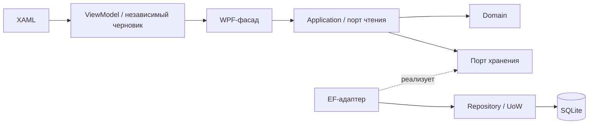

# Итоговый аудит этапа 7

Завершён 26.10.2026 в ветке `feature/refactoring-plans`. Этап 6 завершён ранее
коммитом `162a133`; подтверждение — [аудит этапа 6](refactoring-stage-6-audit.md).
Этот документ описывает фактический результат утверждённого рефакторинга.

## Границы и владение

| Слой | Ответственность | Зависимости |
| --- | --- | --- |
| Bonfire.Domain | Проверенные ID/количества, иммутабельные модели, чистые переходы/геометрия, Result/Option | Runtime |
| Bonfire.Application | Сценарии, независимые DTO и порты чтения/записи/календаря, координация | Domain и runtime |
| BonfireDB | EF-сущности/маппинг, SQLite, короткий UoW, реализации портов | Application/Domain/EF/DI |
| Bonfire | XAML, ViewModel/черновики, адаптеры календаря/диалогов/Excel/файлов и composition root | Контракты; EF только в Data/инициализации/регистрации |

ViewModel/Models/Services не хранят и не возвращают EF. Два намеренных исключения
в WPF-сборке — `Data/DbInitializer.cs` и `Data/DbRegistrator.cs`: запуск и DI.
Ссылки сборок ядра, сигнатуры/состояние UI и фасадов, отсутствие IQueryable в
Application и extension-Map Option защищены ArchitectureBoundaryTests. Аудит
исходников также не обнаружил файловых/процессных/ambient-clock вызовов в ядре.

## Потоки и сохранённые правила

Чтение портами возвращает immutable-снимки; DB-мапперы переиспользуют пакет,
характеристики сорта, записи рассады и ячейки. `Rows` не добавляет Include:
readers явно загружают нужные связи с AsNoTracking. Планировщик выполняет шесть
split-запросов для одного и четырёх участков; ячейки не загружают историю рассады.
Варианты редактора — три проекции без JOIN. Writers сохраняют текущие проверенные
операции и один SaveChanges; история/TPH/Restrict/каскады не перепроектировались.

Семена и рассада самостоятельны; удалённый пакет запрещает только исправление
посева с возвратом. Дефицит доступной рассады видим, не обнуляется. Культура
принадлежит растению, сорт/производитель общие. Отказы не очищают черновик/выбор;
поздние результаты применяются к захваченной цели. None/Some(0)/Some("") и сырые
строки сохраняются в снимках; nullable появляется только на внешних границах.

Отчёт разделён на ReportWorkbookBuilder → ReportPathPolicy → ReportFileWriter;
ReportService координирует Result/UI и локальный TimeProvider. Прежнее сохранение
`Reports/имя_дата.xlsx` сохранено. В исходном сценарии нет выбора диалогом/открытия
файла, поэтому эти действия не добавлены. Неверный срок годности диагностируется
до записи. Excel-группировка, стили, нули и даты проверены существующими тестами.
Заключительная проверка выявила потерю ведущих нулей года 0001: Red
artifacts/stage7-year-format-red, восстановлен формат D4, новая проверка входит
в финальные 1538. Правило даты и данные не менялись.

Удалены EF-API фасадов, старый CopyInto/повторный маппинг, Result.Value/Error с
молчаливым default/null и nullable-обёртка FindFreeSpot. Карта переноса проверок —
[compatibility](refactoring-stage-7-compatibility.md). 56 тестов старых вызовов
репозитория удалены вместе с отсутствующим механизмом; значимые SQLite-сценарии
переведены на актуальные операции. Добавлено 56 проверок этапа 7. Ни один тест
актуальных операций не исключён/не пропущен ради гейта.

## Доказательства завершения

| Проверка | Результат |
| --- | --- |
| `dotnet test Bonfire.sln --no-restore --nologo -v q -m:1 -nr:false -p:UseSharedCompilation=false --logger trx --results-directory artifacts/stage7-final-verified` | 1538/1538; 0 failed/notExecuted, пять TRX |
| Models / Services / ViewModels / Repository / SeedsFromViewModel | 694 / 501 / 302 / 35 / 6 |
| Реальная SQLite | Маппинг, свежие данные, FK/TPH, сохранность истории, отказ/rollback и ошибки чтения |
| Отказ SQL при чтении | Восемь путей дают Failure с причиной; отмена остаётся отменой |
| Информационные панели | SQLite → production readers/DI → ViewModel → XAML; шесть случаев, Active привязки, значения/None/пустая строка/ноль |
| WPF-регрессии | Редакторы, команды, жесты, смена выбора/поздний await и рендеры планировщика входят в общий гейт |
| Процессный smoke | STARTUP_SMOKE_OK; WindowLoaded=True; HostDisposed=True; exit 0 |

Последний smoke использовал только изолированную БД:
`Tests/Startup.Smoke/bin/Debug/net10.0-windows/isolated/0e9b43bb46aa4b8ca46b46510f08e769/smoke.db`.
PNG: `Tests/ViewModels.Tests/bin/Debug/net10.0-windows/visual/stage7/`, четыре
рендера seeds/seedlings при 96/144 DPI; seeds-96 и seedlings-144 просмотрены.
Планировщик/теплица/сетка также заново отрисованы общим гейтом (visual/stage6).

## Практические границы проверки

Растровые WPF-рендеры не заменяют перенос окна между настоящими мониторами,
системные диалоги и ручную проверку всех устройств. Coverlet повторно не запускался:
88,1% — исходный замер, не текущая метрика. Межпроцессная гонка между чтением и
SaveChanges не получила новой политики сериализации. Исторические неизвестные
состояния/фильтры/rounding и игнорирование Rotation сохранены по плану.

Миграции, версии пакетов и рабочая БД не менялись. Предупреждения NuGet NU1902/
NU1903 и исторических PRAGMA остаются известными ограничениями. Push/merge не
выполнялись; `.claude/worktrees` не затрагивалась. Утверждённые этапы 6 и 7 завершены;
эти ограничения перечислены как пределы доказательств, а не как выполненные проверки.
